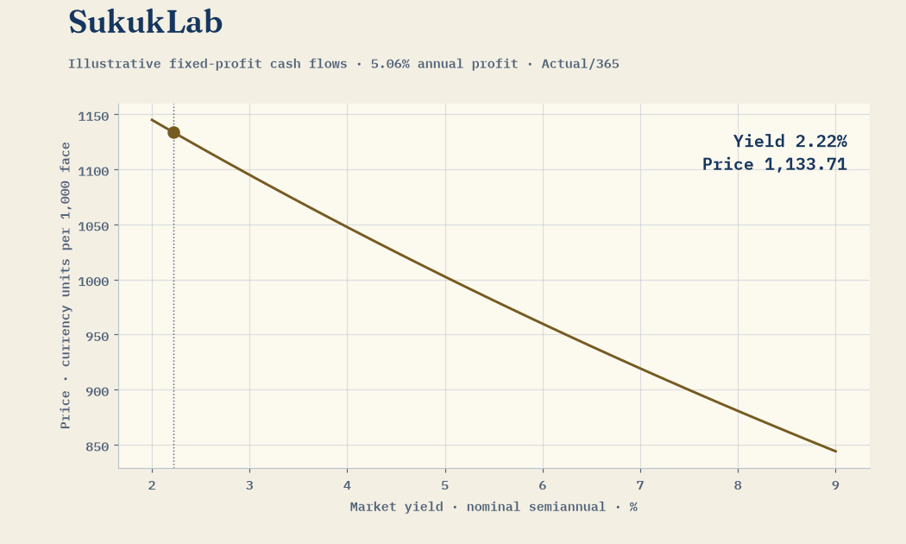
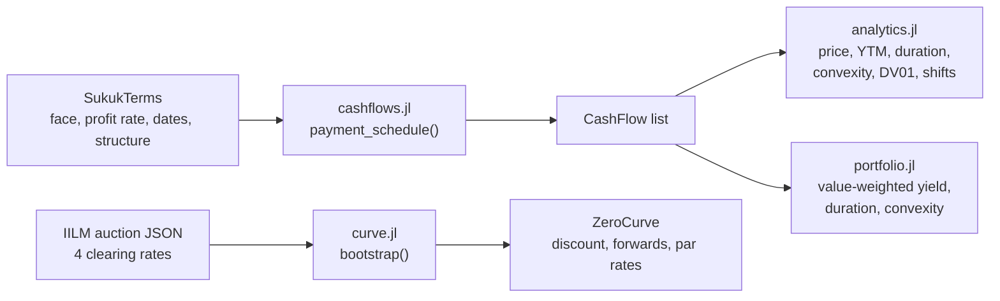

<p align="center"></p>

<h1 align="center">SukukLab</h1>

<p align="center">
  <a href="https://github.com/FaiyazEnayet/sukuklab/actions/workflows/ci.yml"></a>
  
  
</p>

<p align="center">
  <a href="https://faiyazenayet.github.io/sukuklab/docs/dashboard.html"></a>
  <a href="#live-interactive-demo"></a>
  <a href="#quick-start"></a>
</p>

Fixed-income analytics for sukuk, in Julia. One clean library for the instruments: price a fixed-profit-rate sukuk from its cash flows, build a profit-rate curve from published auction results, and measure duration and convexity the way a portfolio manager would. Cash flows, curves, and risk. 

<p align="center"><a href="https://faiyazenayet.github.io/sukuklab/docs/dashboard.html"></a></p>

## Quick start

```julia
using SukukLab, Dates

t = SukukTerms("UAE retail T-Sukuk 2031", 1000.0, 0.0506,
               Date(2026, 9, 30), Date(2031, 9, 30), 2, "ijara")
cfs = payment_schedule(t)          # 10 dated cash flows
y = ytm_from_price(cfs, 1000.0, Date(2026, 10, 10))
macaulay_duration(cfs, y, Date(2026, 10, 10))   # 4.4541 years
```

Clone the repo, then `] instantiate` in Julia 1.10 or newer. `] test` runs the suite. `julia --project=. examples/demo.jl` runs the full demo on real published terms.

## Live interactive demo

`notebook.jl` is a Pluto notebook that tours the toolkit: sliders for profit rate, market yield, maturity and face value with live price and YTM; an ijara/murabaha/wakala picker showing each cash-flow schedule; a bootstrapped curve plot that updates as you move the auction rates.

```julia
using Pluto
Pluto.run(notebook="notebook.jl")
```

No Julia handy? [Open the static snapshot](https://faiyazenayet.github.io/sukuklab/docs/dashboard.html). It renders every notebook section at the default values, each computed by running the code. Serve the `docs/` folder from any static host (GitHub Pages works) to put it online.

## How the pieces fit



| File | What it does |
|---|---|
| `src/sukuklab.jl` | Package entry point. Re-exports everything. |
| `src/sukuk.jl` | Closed-form pricing and yield to maturity for plain fixed-profit-rate sukuk. |
| `src/cashflows.jl` | Distribution schedules for ijara, murabaha and wakala structures, bullet and installment shapes, 30/360 and Actual/365 day counts, accrued profit. |
| `src/curve.jl` | Zero profit-rate curves, discount factors, forward rates, par rates, bootstrapping from market instruments. |
| `src/analytics.jl` | Yield to maturity, current yield, Macaulay and modified duration, convexity, DV01, parallel shift repricing. |
| `src/portfolio.jl` | Market-value-weighted yield, duration and convexity across holdings. |

Ijara, murabaha and wakala are named here as financial mechanics. An ijara sukuk pays lease-based periodic distributions with principal at maturity. A murabaha sukuk reflects a deferred sale: cost plus agreed profit, paid as a bullet or in installments. A wakala sukuk pays distributions from an agency-managed pool. The library models the cash-flow shapes that follow from each structure. Nothing more.

## Measured results

Every number here comes from `examples/demo.jl`, run on 2026-10-11.

Real published data from a bootstrapped a short end zero curve: the IILM short-term sukuk auction of January 2026, clearing at 3.81% (1m), 3.84% (3m), 3.82% (6m) and 3.45% (12m). The curve recovers every auction point exactly, as a bootstrap should:

| Pillar | Zero rate |
|---|---|
| 0.085y | 3.8038% |
| 0.247y | 3.8219% |
| 0.496y | 3.7843% |
| 1.000y | 3.3918% |

The 6m to 12m forward rate is 3.0026%. The published 12m clearing rate sat below the 6m rate, and the curve keeps that shape.

I ran the analytics on real published terms: the UAE sovereign retail T-Sukuk, 5-year, 5.06% annual, semi-annual, maturing 2031-09-30. Valued 2026-10-10 at a clean price of 1000 on 1000 face: YTM 5.089%, Macaulay duration 4.4541y, modified duration 4.3436y, convexity 22.3272, DV01 0.4344 per 1000 face. A 100bp parallel rise reprices it to 957.66. Accrued profit at settlement: 1.41.

The portfolio demo uses three illustrative holdings and is labeled synthetic in the script: value 99,800, weighted YTM 5.8005%, weighted duration 2.762y, weighted convexity 10.5031.

The full suite is 83 tests, all passing: pricing and yield roundtrips, schedule shapes and day counts, curve interpolation and bootstrap recovery on a synthetic flat curve, bootstrap on the real IILM auction, duration against finite differences, convexity sign, DV01 against a 1bp reprice, and portfolio weighting.

## Real data

Two public sources feed the demo. The IILM auction results are published clearing profit rates from January 2026, archived in `data/iilm_2026-01.json` with the source note. I treat them as simple annualized discount rates (Actual/365); that is a documented modeling choice, not a quoted convention. The UAE retail sukuk terms (5.06%, semi-annual, 2031-09-30 maturity) come from Nasdaq Dubai listing reports. Everything else in the demo is synthetic and labeled so.

## References

IILM short-term sukuk auction results, January 2026. Nasdaq Dubai sukuk listing announcements. Standard fixed-income texts for duration and convexity arithmetic.

## Honest limitations

The IILM curve covers only the short end: one month to one year, four points, one auction date. It is a primary-market snapshot, not a live secondary curve. Different credits sit at different levels, so do not mix these pillars with other issuers' paper. The UAE example uses published issuance terms; I have no secondary prices for it, so its risk numbers are computed at par. Day-count and compounding conventions are documented choices; check them against your market before relying on them. The static dashboard shows the notebook's default values only; the sliders live in Pluto. This is analytics code, not investment advice.
