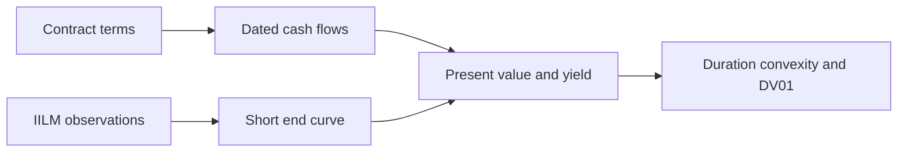
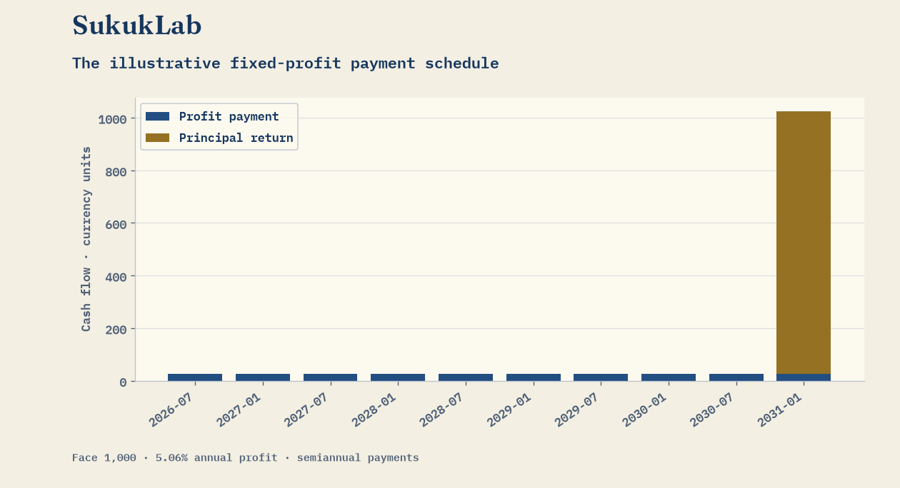

<p align="center"></p>

[](https://github.com/FaiyazEnayet/sukuklab/actions/workflows/ci.yml) [](LICENSE)   [](https://faiyazenayet.github.io/sukuklab/docs/dashboard.html)

<p align="center"><a href="https://faiyazenayet.github.io/sukuklab/docs/dashboard.html"><b>Open interactive demo</b></a> · <a href="#method">Method</a> · <a href="#run-locally">Run locally</a></p>

# SukukLab

SukukLab makes the relationship between contract cash flows, yield and interest-rate sensitivity explicit. It provides pricing, yield solving, duration, convexity and curve tools with inspectable conventions.


[](https://faiyazenayet.github.io/sukuklab/docs/dashboard.html)


Valuation is most useful when the assumptions can be traced from contract cash flows to discount factors. Compare maturity, principal repayment and profit timing before interpreting a difference in price or duration. The January 2026 IILM observations provide a dated market reference; the illustrative structures support financial comparison without establishing legal or Sharia compliance.

## Explore

- Adjust market yield and inspect the resulting price and risk measures.
- Compare contract schedules without treating analytics as a compliance opinion.
- Inspect the observed curve pillars and their January 2026 context.

## Method

Dated cash flows are discounted under the selected rate convention. Price-yield sensitivities are calculated from the same schedules. A short-end curve uses four published IILM auction observations from January 2026.

## Evidence at a glance

| Scope | Recorded result or contract |
| :--- | :--- |
| Curve source | Four IILM maturity pillars from January 2026 |
| Dashboard illustrative default | Face 1,000; annual profit rate 5.06%; semiannual payments |
| Same default at 5% nominal yield | Price 999.90; modified duration 4.3711 years |
| Rate convention | Nominal semiannual yield; Actual/365 date fractions in this view |

## Run locally


```sh
python -m pip install -r portfolio_ui/requirements.txt
julia --project=. -e 'using Pkg; Pkg.instantiate(); Pkg.test()'
julia --project=. examples/make_dashboard.jl
```

## Technical design

Contract terms generate dated cash flows before any valuation is calculated. The analytics layer solves yield from price and computes duration, convexity and DV01 from those same payments. Curve discounting is a separate path, with continuously compounded zero rates and explicit date-fraction conventions.



## Evaluation protocol

The January 2026 IILM auction observations anchor a short-end curve, not a current market curve. The dashboard example is an illustrative fixed-profit schedule; published retail sukuk terms and synthetic portfolio holdings in the repository have their own valuation context. Matching instruments and conventions is necessary before comparing numbers.



Price decreases as the discount yield rises. Duration summarizes first-order sensitivity, while convexity describes curvature. Neither sensitivity measure determines credit quality, liquidity, enforceability or Sharia compliance.

## Code and data

`src/cashflows.jl` defines schedules. `analytics.jl` contains yield and sensitivity calculations. `curve.jl` builds curves. `data/iilm_2026-01.json` records the auction context. The redesigned dashboard also has a Python presentation alternative.


## Limitations

- The IILM observations cover one auction date and only the short end.
- Illustrative contract comparisons do not establish legal or Sharia compliance.
- Curve construction should reject duplicate pillars and non-finite inputs explicitly.

## License

[MIT](LICENSE). Third-party datasets, libraries and fonts retain their own terms.
