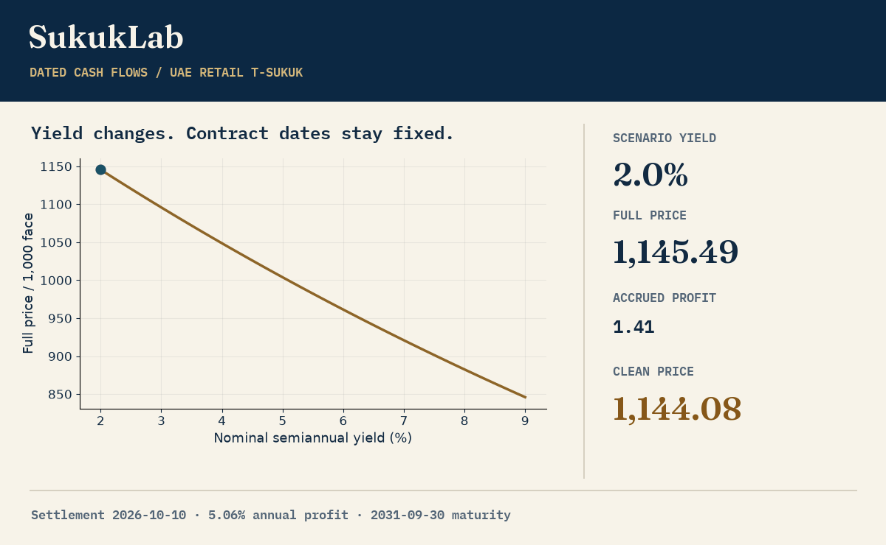
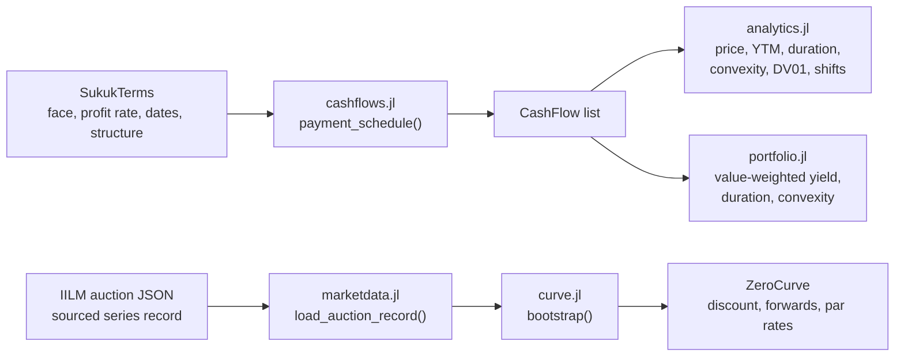

<p align="center"></p>

<h1 align="center">SukukLab</h1>

<p align="center">
  <a href="https://github.com/FaiyazEnayet/sukuklab/actions/workflows/ci.yml"></a>
  
  
</p>

<p align="center">
  <a href="https://faiyazenayet.github.io/sukuklab/docs/dashboard.html"></a>
  <a href="#live-interactive-demo"></a>
  <a href="#quick-start"></a>
</p>

Fixed-income analytics for sukuk, in Julia. One clean library for the instruments: price a fixed-profit-rate sukuk from its cash flows, build a profit-rate curve from published auction results, and measure duration and convexity the way a portfolio manager would. Cash flows, curves, and risk. 

<p align="center"><a href="https://faiyazenayet.github.io/sukuklab/docs/dashboard.html"></a></p>

## Quick start

```julia
using SukukLab, Dates

t = SukukTerms("UAE retail T-Sukuk 2031", 1000.0, 0.0506,
               Date(2026, 9, 30), Date(2031, 9, 30), 2, "ijara")
cfs = payment_schedule(t)          # 10 dated cash flows
y = ytm_from_price(cfs, 1000.0, Date(2026, 10, 10))
macaulay_duration(cfs, y, Date(2026, 10, 10))   # 4.4541 years
```

Clone the repo, then `] instantiate` in Julia 1.10 or newer. `] test` runs the suite. `julia --project=. examples/demo.jl` runs the full demo on real published terms.

## Live interactive demo

`notebook.jl` is a Pluto notebook that tours the toolkit: sliders for profit rate, market yield, maturity and face value with live price and YTM; an ijara/murabaha/wakala picker showing each cash-flow schedule; a bootstrapped curve plot that updates as you move the auction rates.

```julia
using Pluto
Pluto.run(notebook="notebook.jl")
```

No Julia handy? [Open the dashboard](https://faiyazenayet.github.io/sukuklab/docs/dashboard.html). It presents the sourced IILM series record, calibrated short curve, and the UAE retail T-Sukuk's dated cash-flow valuation. Its yield control reprices the recorded cash flows locally. Serve the `docs/` folder from any static host (GitHub Pages works) to put it online.

## How the pieces fit



| File | What it does |
|---|---|
| `src/SukukLab.jl` | Package entry point. Re-exports everything. |
| `src/sukuk.jl` | Closed-form pricing and yield to maturity for plain fixed-profit-rate sukuk. |
| `src/cashflows.jl` | Distribution schedules for ijara, murabaha and wakala structures, bullet and installment shapes, generated from the contractual anchor with explicit regular and stub periods, 30/360 and Actual/365 day counts, accrued profit. |
| `src/curve.jl` | Zero profit-rate curves, discount factors, forward rates, par rates, bootstrapping from market instruments. |
| `src/marketdata.jl` | Validated loader for published auction records: series and ISIN identifiers, actual issue and maturity dates, provenance and quotes, and model pricing under the record's named rate convention. |
| `src/analytics.jl` | Yield to maturity, full/accrued/clean price decomposition, current yield, Macaulay and modified duration, convexity, DV01, parallel shift repricing. |
| `src/portfolio.jl` | Market-value-weighted yield, duration and convexity across holdings. |

Ijara, murabaha and wakala are named here as financial mechanics. An ijara sukuk pays lease-based periodic distributions with principal at maturity. A murabaha sukuk reflects a deferred sale: cost plus agreed profit, paid as a bullet or in installments. A wakala sukuk pays distributions from an agency-managed pool. The library models the cash-flow shapes that follow from each structure. Nothing more.

## Measured results

Every number here is computed by the package from the archived inputs and recorded in the canonical results file `examples/results.json`; the test suite recomputes them and checks the quoted values against it.

Real published data from a bootstrapped short end zero curve: the IILM short-term sukuk auction of January 2026, clearing at 3.81% (1m), 3.84% (3m), 3.82% (6m) and 3.45% (12m). The four series were issued on 2026-01-15 and mature on their actual published dates, so the curve anchors on the issue date and each pillar sits at its real time to maturity. The curve recovers every auction point exactly, as a bootstrap should:

| Pillar | Zero rate |
|---|---|
| 0.112y | 3.8019% |
| 0.230y | 3.8231% |
| 0.518y | 3.7827% |
| 0.997y | 3.3920% |

The 6m to 12m forward rate is 2.9987%. The published 12m clearing rate sat below the 6m rate, and the curve keeps that shape.

I ran the analytics on real published terms: the UAE sovereign retail T-Sukuk, 5-year, 5.06% annual, semi-annual, maturing 2031-09-30. Valued at settlement 2026-10-10, ten days after the 2026-09-30 distribution: the full price is 1000 on 1000 face, of which 1.41 is profit accrued since that distribution, so the clean price is 998.59. YTM 5.089%, Macaulay duration 4.4541y, modified duration 4.3436y, convexity 22.3272, DV01 0.4344 per 1000 face. A 100bp parallel rise reprices the full price to 957.66.

The portfolio demo uses three illustrative holdings and is labeled synthetic in the script: value 99,800, weighted YTM 5.8005%, weighted duration 2.762y, weighted convexity 10.5031.

The full suite is 483 tests, all passing: pricing and yield roundtrips, schedule shapes and day counts, anchor-generated month-end and leap-day schedules with explicit stub periods, the bond-basis 30/360 reference values (including a February-end to February-end span across a leap day), a seven-month semiannual instrument whose one-month final stub pays its 30/360 fraction, full/accrued/clean price decomposition and clean-price yield roundtrips, curve interpolation and bootstrap recovery on a synthetic flat curve, bootstrap on the real IILM auction, curve pillar and quote validation with calibration diagnostics (flat, non-flat, between-pillar, steep and infeasible quote sets repriced against independently computed prices), the published-terms IILM reconstruction fixture with its loader validation, duration against finite differences, convexity sign, DV01 against a 1bp reprice, and portfolio weighting. The suite also guards the scope of the library itself: every source file under `src/` must be included by the package entry point, the package version must match the latest CHANGELOG release heading, and the canonical results file must match a fresh recomputation.

## Reproducing the results

From a clean checkout, with Julia 1.13 (the version pinned in CI and recorded in `examples/results.json`; the package declares compatibility with Julia 1.10 and newer):

```bash
julia --project=. -e 'using Pkg; Pkg.instantiate(); Pkg.test()'
julia --project=. examples/demo.jl
julia --project=. examples/make_results.jl
julia --project=. examples/make_dashboard.jl
julia --project=. examples/make_iilm_residuals.jl
python3 test/check_parity.py
```

The demo recomputes every number in Measured results from the archived inputs. `make_results.jl` regenerates the canonical results file (`examples/results.json`) and the shared valuation fixtures (`test/fixtures/valuation_parity.json`) from the package alone; CI fails if the checked-in files differ from a fresh regeneration. `make_dashboard.jl` renders the playground snapshot from the canonical results file and then runs the Python presentation step that produces `docs/dashboard.html`. `make_iilm_residuals.jl` regenerates the IILM pricing-residual report (`examples/iilm_residuals.json` and `examples/iilm_residuals.csv`): each series' model price under the documented convention against its curve repricing, recorded with the SHA-256 of the source data file. `check_parity.py` is a standard-library-only Python implementation of the same documented pricing formulas, and verifies that Julia and Python valuations agree to within 1e-8 per 1,000 face on the shared fixtures.

## Real data

Two public sources feed the demo. The IILM record in `data/iilm_2026-01.json` reconstructs the January 2026 auction from its published series terms: series and ISIN identifiers, amounts, clearing profit rates, and the actual issue (2026-01-15) and maturity dates, taken from the IILM press release and auction results table and the Fitch Ratings Japan register, with the auction date (2026-01-13) stored separately as the observation time and the verbatim press-release quote kept for each series. A validated loader in the package reads that record; the demo, the notebook, the dashboard builder and the results generator all consume it instead of deriving dates from tenor labels. I treat the published rates as simple annualized discount rates (Actual/365); that is a documented modeling choice, not a quoted convention, and no clearing prices are recorded, because none are published with the rates. The UAE retail sukuk terms (5.06%, semi-annual, 2031-09-30 maturity) come from Nasdaq Dubai listing reports. Everything else in the demo is synthetic and labeled so.

## References

IILM short-term sukuk auction results, January 2026. Nasdaq Dubai sukuk listing announcements. Standard fixed-income texts for duration and convexity arithmetic.

## Honest limitations

The IILM curve covers only the short end: four dated instruments from one auction. It is a primary-market observation, not a live secondary curve. Different credits sit at different levels, so do not mix these pillars with other issuers' paper. The UAE example uses published issuance terms; I have no secondary prices for it, so its risk numbers are computed at par. Day-count and compounding conventions are documented choices; check them against your market before relying on them. The dashboard explores the recorded curve and reprices the UAE example by yield; Pluto includes the broader instrument controls. This is analytics code, not investment advice.
